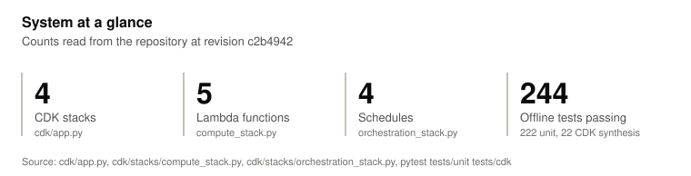
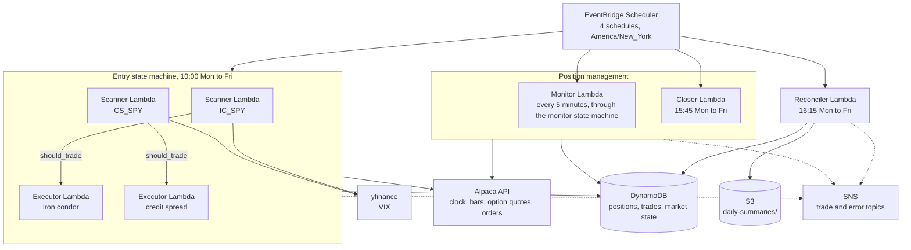

# premium-selling

Same-day (0DTE) SPY option spread system on AWS: five Lambda functions on one container image, run by Step Functions and EventBridge Scheduler, with positions and trades in DynamoDB, deployed as four CDK stacks.

<picture>
  <source media="(prefers-color-scheme: dark)" srcset="docs/figures/system-at-a-glance-dark.svg">
  
</picture>

<details><summary>Data table</summary>

| Measure | Value |
|---|---|
| CDK stacks | 4 |
| Lambda functions | 5 |
| Schedules | 4 |
| Offline tests passing | 162 |

Source: `cdk/app.py`, `cdk/stacks/compute_stack.py`, `cdk/stacks/orchestration_stack.py`, and `pytest tests/unit tests/cdk` at revision `4b1dc2f`. Chart data: `docs/data.json`.

</details>

## What it does

- Classifies each trading day at 10:00 Eastern as range, uptrend, downtrend or uncertain from one-minute SPY bars since the open: VWAP crosses, position against VWAP, opening range breakout and candle body ratio (`src/market/regime.py`).
- Defines two strategies on one paper trading account (`src/common/config.py`). `IC_SPY` sells an iron condor on range days. `CS_SPY` sells a credit spread in the direction of the trend on trend days.
- Picks the short strike by delta and the long strike a fixed width away, and submits the spread as one multi-leg limit order for the net credit (`src/strategy/`, `src/executor/handler.py`).
- Checks open positions every 5 minutes and closes a spread when its value reaches 2 times the credit received or falls to half of it (`src/monitor/handler.py`).
- Closes every open position at 15:45 Eastern (`src/closer/handler.py`).
- Writes a daily summary to S3 at 16:15 Eastern and sends it over SNS, with a count of positions still open (`src/reconciler/handler.py`).

## How it works



Every function except the Reconciler reads the broker keys from the Secrets Manager secret `premium/spy-api` (`src/common/alpaca_clients.py`, `src/common/config.py`).

The five functions share the image built from `src/Dockerfile`; each overrides the command (`cdk/stacks/compute_stack.py`).

| Function | Trigger | Memory, timeout | Work |
|---|---|---|---|
| Scanner | Entry state machine, once per strategy | 1,024 MB, 120 s | Stops if the market is closed, the strategy has 3 open positions or there are fewer than 5 bars. Otherwise classifies the regime and returns `should_trade` when the regime matches the strategy with confidence of at least 0.6 (`src/scanner/handler.py`). |
| Executor | Entry state machine, when `should_trade` is true | 512 MB, 120 s | Requests quotes for 15 strikes on each side of the money, builds the spread, submits the order and records the position and an open trade (`src/executor/handler.py`). |
| Monitor | Monitor state machine | 512 MB, 60 s | Returns early outside 9:35 to 16:00 Eastern and when nothing is open. Otherwise reprices each leg at the mid and closes on the stop or take profit threshold (`src/monitor/handler.py`). |
| Closer | Scheduler, 15:45 | 512 MB, 120 s | Reprices and closes every open position (`src/closer/handler.py`). |
| Reconciler | Scheduler, 16:15 | 512 MB, 120 s | Builds the daily summary from the trades table and writes it to S3 (`src/reconciler/handler.py`). |

The three cron schedules carry the time zone `America/New_York`, so they follow daylight saving time. The monitor schedule is `rate(5 minutes)` (`cdk/stacks/orchestration_stack.py`).

Storage (`cdk/stacks/storage_stack.py`, `src/common/dynamo_io.py`):

| Resource | Keys | Retention |
|---|---|---|
| DynamoDB `premium-positions` | `strategy`, `spread_id` | Point-in-time recovery; retained on stack delete |
| DynamoDB `premium-trades` | `strategy`, `trade_id` | Point-in-time recovery; retained on stack delete |
| DynamoDB `premium-market-state` | `date`, `timestamp` | Items expire 30 days after they are written (`ttl_epoch`) |
| S3 `premium-selling-data-<account id>` | `daily-summaries/<date>.json` | Infrequent Access after 30 days, expire after 365 |

## Quickstart

Requires Python 3.12 and [uv](https://docs.astral.sh/uv/). The CDK tests also need Node.js.

```bash
git clone https://github.com/darblinko/spy-0dte-spreads
cd spy-0dte-spreads
uv run --group dev python -m pytest                              # 157 unit tests, no AWS access
uv run --group cdk --group dev python -m pytest tests/cdk        # 5 CDK synthesis tests
uvx ruff check . && uvx ruff format --check .
```

Deploying needs an AWS account, Docker and the CDK CLI (`npm install -g aws-cdk`). The broker keys are read from the environment; the variable names are in `.env.example`.

```bash
uv sync --group cdk && source .venv/bin/activate
python scripts/seed_secrets.py             # writes ALPACA_API_KEY and ALPACA_API_SECRET to premium/spy-api
cd cdk && cdk deploy --all
```

The trading client is created with `paper=True` (`src/common/alpaca_clients.py`). The schedules are enabled on deploy.

## Project layout

```
cdk/
  app.py                  four stacks: Storage, Observability, Compute, Orchestration
  stacks/                 one module per stack
src/
  Dockerfile              shared image for all five functions
  common/                 config, models, DynamoDB and S3 access, broker clients, SNS, metrics
  market/                 VWAP, opening range, expected move, regime classification
  strategy/               strike selection, iron condor, credit spread
  scanner/ executor/      entry workflow functions
  monitor/ closer/        position management functions
  reconciler/             end-of-day summary
scripts/
  seed_secrets.py         environment to Secrets Manager
tests/
  unit/                   157 tests with mocks, no AWS access
  cdk/                    5 synthesis tests
docs/                     chart data, README figures, landing page
```

## Design decisions and limitations

- Option symbols are built with the strike as a plain integer: `f"{int(leg.strike):08d}"` in `src/executor/handler.py` and `src/monitor/handler.py`, and `:08.0f` in `src/scanner/handler.py`. The OCC symbol format encodes the strike multiplied by 1,000, as in the fixture `SPY260404P00520000` for a 520 strike (`tests/unit/test_models.py`). The generated symbols therefore name strikes 1,000 times too small. Inference, not verified against the broker: chain requests return no quotes, the executor builds no spread, and the expected move always takes the fallback of 1% of the SPY price.
- Six configuration fields are not read by any code: `earliest_entry`, `latest_entry`, `force_close_time`, `regime_detection_time`, `max_daily_loss` and `position_size_pct` (`src/common/config.py`). There is no daily loss limit, every order is for 1 spread, and the entry and close times are set only by the schedules.
- No code checks order fills. The executor records a position once the order is submitted. `_close_position` in `src/monitor/handler.py` marks a position closed and records the close trade whether or not the close order was submitted.
- VIX is fetched from yfinance and stored with the regime signals, but it does not enter the regime score (`src/market/regime.py`). A failed fetch uses 20.0 (`src/scanner/handler.py`).
- The CloudWatch dashboard plots four custom metrics in the `Premium/Trading` namespace (`cdk/stacks/observability_stack.py`). `publish_metric` in `src/common/metrics.py` has no callers, so the dashboard has no data. There are no CloudWatch alarms; errors are reported by the handlers to the SNS error topic, and the topics have no subscriptions.
- The monitor schedule fires 288 times a day on every day of the week. The handler checks the clock time but not the weekday or market holidays; a run with no open positions makes no broker calls.
- Both strategies use the same secret and therefore the same broker account (`src/common/config.py`).
- The repository contains no backtest, no simulation and no trading record. Nothing in it shows that the strategies have an edge.
- CI runs only offline tests. There are no integration tests against a deployed stack.

## Not investment advice

This repository is published as a software engineering example. It is not investment advice, a recommendation to trade any security or strategy, or an offer of any service. Options trading can lose more than the credit received, and trading can lose the capital invested. The code comes with no warranty; see the license. Anyone who runs it against a brokerage account does so at their own risk.

## License

Apache-2.0. See [LICENSE](LICENSE).
